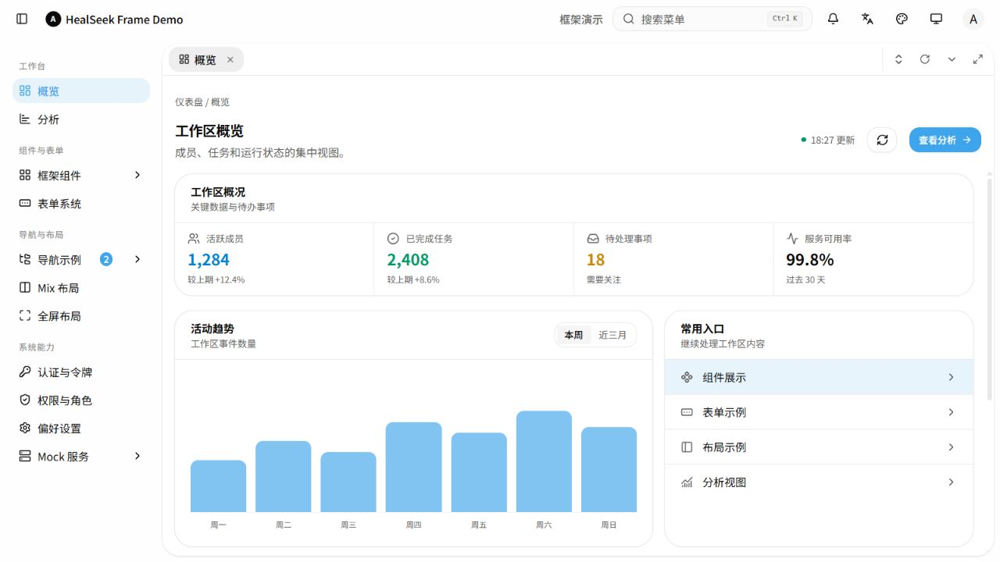
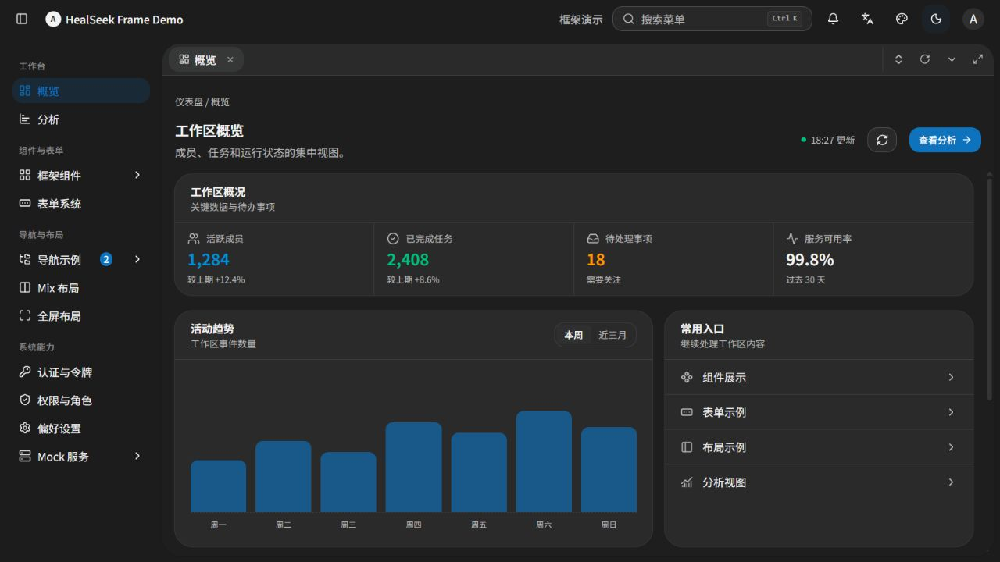
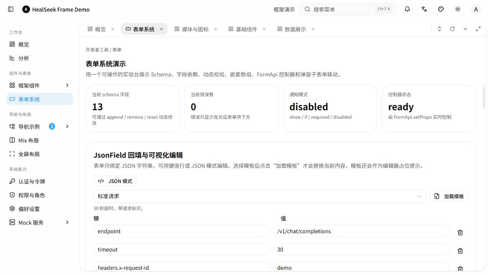
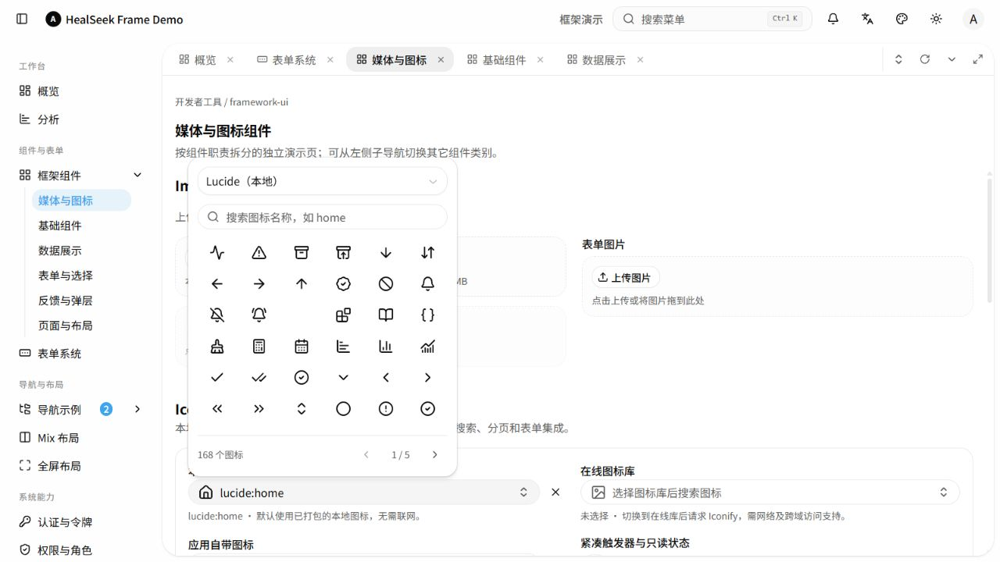

# HealSeek Frame

[](https://github.com/Airsado/airovo-frame)
[](https://github.com/Airsado/airovo-frame/tree/dev)
[](https://nodejs.org/)
[](https://pnpm.io/)

面向 Vue 3 中后台应用的可复用框架工作区，基于 TypeScript、Vite、Tailwind CSS 和 shadcn-vue 构建，框架与工具包统一使用 `@healseek/*`。

框架提供布局、主题、路由、权限、请求、认证状态、标签页和表单等通用能力；应用保留页面、API、认证流程与业务组件的控制权。

> 当前在 `dev` 分支持续迭代，尚未发布稳定版本。适合学习、二次开发与集成验证，暂不作为稳定的生产依赖。

## 界面预览

以下为公开 Demo 的真实运行截图，使用通用 Mock 数据，不包含私有业务应用。截图日期：2026-11-22，桌面视口：1280 × 720。点击图片可查看原图。

| 工作台 · 浅色                                                                                                | 工作台 · 深色                                                                                              |
| ------------------------------------------------------------------------------------------------------------ | ---------------------------------------------------------------------------------------------------------- |
| [](docs/assets/readme/overview-light.jpg) | [](docs/assets/readme/overview-dark.jpg) |
| 表单系统 · JsonField 可视化编辑                                                                              | 框架组件 · 媒体与图标选择                                                                                  |
| [](docs/assets/readme/form-system.jpg) | [](docs/assets/readme/components.jpg)        |

截图来自本地运行环境，并非已部署的在线演示站。启动方式见下方；截图范围与限制见 [视觉验收记录](docs/ui-visual-verification.md)。

## 核心能力

- **统一启动**：`createApp({ root, preferences })` 创建单一运行时，请求、路由和语言包由应用预先注册。
- **应用壳层**：融合式 Header / Sidebar、圆角工作区、标签页、KeepAlive、主题设置与国际化。
- **路由与认证**：前端、后端及混合菜单模式，动态路由、权限守卫、认证状态和会话过期 UI；业务认证流程由应用维护。
- **表单系统**：`AForm`、`useForm`、`useAForm` 和 `FormApi` 共用契约，支持动态字段、依赖、校验、嵌套数组与弹窗联动。
- **数据与交互组件**：`DataTable` / `useDataTable`、服务端分页、筛选排序、选择状态、请求取消与重试，以及 Modal、Drawer、选择器和状态组件。
- **实时数据**：SSE transport / session，支持 Last-Event-ID、退避重连、心跳、暂停恢复与有界去重缓冲。
- **开箱集成示例**：独立 Nitro Mock API 与工作区应用脚手架，演示登录、注册、刷新令牌、菜单和权限接入。

## 快速开始

环境要求：Node.js `20.19.x` 或 `>=22.12.0`，pnpm `9.15.4`。在仓库根目录执行：

```bash
corepack enable
corepack prepare pnpm@9.15.4 --activate
pnpm install
pnpm dev:demo
```

- 演示入口：<http://localhost:5174/dashboard/overview>
- 演示账号：`admin` / `123456`，仅用于本地 Mock。
- Mock API：<http://127.0.0.1:4174>，由 `dev:demo` 一并启动。

如果前端端口已被占用，以 Vite 终端输出的实际地址为准；本轮截图使用 `5175`。仓库的 `preinstall` 会检查 pnpm 版本，修改依赖或 workspace 配置后需重新执行 `pnpm install`。

### 创建业务应用

```bash
pnpm create:app my-app
pnpm install
pnpm dev my-app --mock
```

脚手架生成 `apps/my-app`，包含应用入口、偏好设置、请求配置、认证 handlers、路由、语言包与可替换的登录/注册页面。它依赖 workspace / catalog，须从本仓库根目录或 `apps/` 运行，不能作为独立项目安装。

详细步骤见 [新应用接入指南](docs/architecture/starter-integration.md)。当前脚手架尚未作为独立 npm 工具发布。

## 日常开发

```bash
# 交互选择应用，再选择是否同时启动 Mock API
pnpm dev

# 指定应用；接真实后端时不加 --mock
pnpm dev my-app
pnpm dev my-app --mock

# 查看可运行应用，或显式启动全部应用
pnpm dev --list
pnpm dev:all
```

启动器自动发现 `apps/*` 下包含 `dev` 脚本的应用，支持应用目录名或包名；保留 Turbo 依赖预构建，不启动其它应用或内部工具的监听任务。非交互环境须明确指定应用或使用 `dev:all`。

### 验证命令

```bash
# 包名、内部依赖、源码引用与生产配置一致性
pnpm test:branding

# Demo 类型检查、生产构建与单元测试
pnpm --filter playwright build
pnpm --filter playwright test

# 按改动范围选择包测试和 Mock 类型检查
pnpm --filter @healseek/forms test
pnpm --filter @healseek/app test
pnpm --filter mock-api typecheck

# 整个工作区（包含本地接入的业务应用）
pnpm lint
pnpm build
```

大多数框架包直接从源码消费，Demo 的 `build` 会先执行 `vue-tsc --noEmit`，覆盖跨包类型检查。修改 `internal/vite-config` 源码后，先运行 `pnpm --filter @healseek/vite-config build`。

## 目录与职责

```text
apps/
  playwright/                 # 公开 Demo 与框架集成示例
  mock-api/                   # 独立 Nitro Mock API
app-ui/                       # 应用业务组合与 DIY 扩展
packages/
  core/
    app/                      # createApp、AppShell 与启动上下文
    components/               # 业务无关的框架组合组件
    forms/                    # AForm、useForm、useAForm、FormApi
    layouts/                  # Header、Sidebar 与主题设置
    config/                   # Preferences 默认值、解析与持久化
    router/                   # 路由、菜单与守卫
    request/                  # Axios、令牌注入与错误标准化
    stores/                   # 认证、偏好、语言与标签页状态
    permission/               # RBAC、菜单过滤与权限指令
    tabs/                     # 标签页与 KeepAlive 控制器
    views/                    # 默认登录、注册与错误页面 UI
    composables/              # Modal、Toast 等通用控制器
  ui-kit/shadcn-vue/          # CLI 管理的基础组件源码
  shared/                     # 图标与通用工具
internal/
  create-app/                 # 应用脚手架与模板
  vite-config/                # 共享 Vite 配置
```

框架行为放在 `packages/core`；业务页面、API、认证 handlers 和第三方 Provider 放在应用内。`app-ui` 不承载框架能力；shadcn-vue 基础组件通过框架层组合，不直接写入业务行为。应用源码使用 `#` 别名，`@` 保留给 shadcn-vue 内部路径。

### 应用启动契约

```ts
import "./api/request";
import "./router";
import "./locales";

import App from "./App.vue";
import preferences from "./preferences";
import { createApp } from "@healseek/app";

const { mount } = await createApp({ root: App, preferences });
mount("#app");
```

`createApp()` 只接收 `root` 与可选的 `preferences`，只返回 `mount`。应用通过注册模块配置请求、路由、语言和会话恢复，不注入第二套 Pinia、Axios 或 Router。默认登录/注册页只提供 UI，登录、刷新令牌和退出逻辑由应用的 `auth/handlers.ts` 编排。

完整 API 与职责边界见 [框架能力与启动契约](docs/architecture/framework-capabilities.md)。

## 配置与命名

应用环境变量按 `.env`、`.env.development`、`.env.production` 分层，主要包括：

- `VITE_APP_TITLE`、`VITE_APP_NAMESPACE`：应用标题与持久化命名空间。
- `VITE_PORT`、`VITE_BASE`：开发端口与部署路径。
- `VITE_GLOB_API_URL`、`VITE_NITRO_MOCK`：后端地址与本地 Mock 代理。
- `VITE_ROUTER_HISTORY`：路由 history 模式。

`VITE_*` 会进入浏览器，不能存放密码、私钥或其他秘密。机器相关覆盖放在已忽略的 `.env.local` 或 `.env.<mode>.local`。

框架名称为 **HealSeek Frame**，根工作区包名为 `healseek-frame`（不发布）；框架与工具包统一为 `@healseek/*`。脚手架包为 `@healseek/create-app`，CLI 入口为 `create-healseek`，仓库内仍使用 `pnpm create:app <name>`。

应用名称、`VITE_APP_NAMESPACE` 和历史存储键保持兼容，避免品牌更名导致已有登录状态与偏好设置丢失。GitHub 链接仍指向实际仓库；品牌更名不代表已完成仓库转移、域名部署或 npm 发布。

## 文档导航

- 接入：[框架能力与启动契约](docs/architecture/framework-capabilities.md) · [新应用接入](docs/architecture/starter-integration.md) · [API 迁移说明](docs/architecture/api-migration.md)
- 架构：[表单与路由](docs/architecture/routing-and-forms.md) · [Issue 能力边界](docs/architecture/issue-capabilities.md) · [app-ui 边界](app-ui/README.md)
- 演示：[Demo 说明](apps/playwright/README.md) · [Mock API](apps/mock-api/README.md)
- UI：[参考源码映射](docs/ui-source-map.md) · [视觉验收记录](docs/ui-visual-verification.md)
- 协作：[贡献流程](CONTRIBUTING.md) · [Issue 与标签规范](docs/issue-management.md) · [Agent 入口](AGENTS.md)

## 项目状态与贡献

日常迭代目标分支为 `dev`。欢迎提交问题、建议与修复；涉及架构调整时，请先说明场景和兼容性影响。一次修复聚焦一个独立问题，验证与提交要求见 [CONTRIBUTING.md](CONTRIBUTING.md)。

正式开源发布前仍需补充根目录许可证和版本发布流程；包内的 `MIT` 声明仅表示包级别的预期许可证信息，不等同于完整的仓库许可证。

## 参考与致谢

- [new-api](https://github.com/QuantumNous/new-api)：后台布局、侧栏、圆角工作区、主题与弹层交互参考。
- [vue-vben-admin](https://github.com/vbenjs/vue-vben-admin)：工程分层、Preferences、路由、请求、表单与控制器设计参考。
- [shadcn-vue](https://www.shadcn-vue.com/)：基础组件与源码管理方式，组件位于 `packages/ui-kit/shadcn-vue`。
- [Nitro](https://nitro.build/)：独立 Mock 服务与演示 API。

本项目保留独立的 API、目录结构与实现，不将参考项目作为运行时适配层；具体参考位置见 [UI 参考源码映射](docs/ui-source-map.md)。
